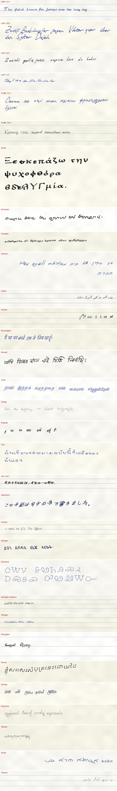
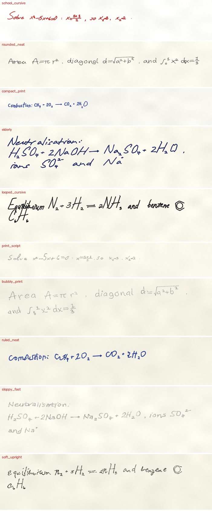
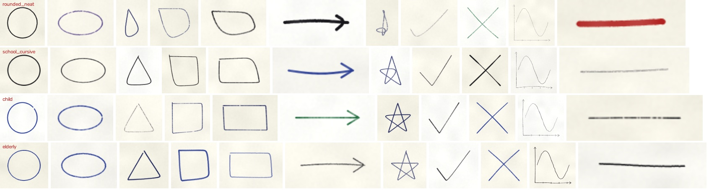
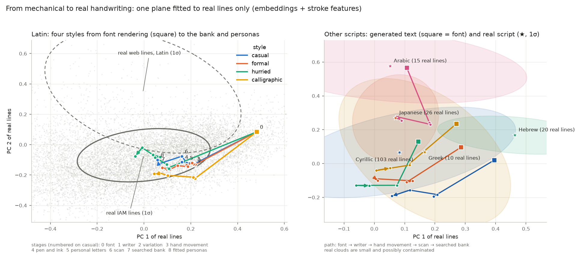
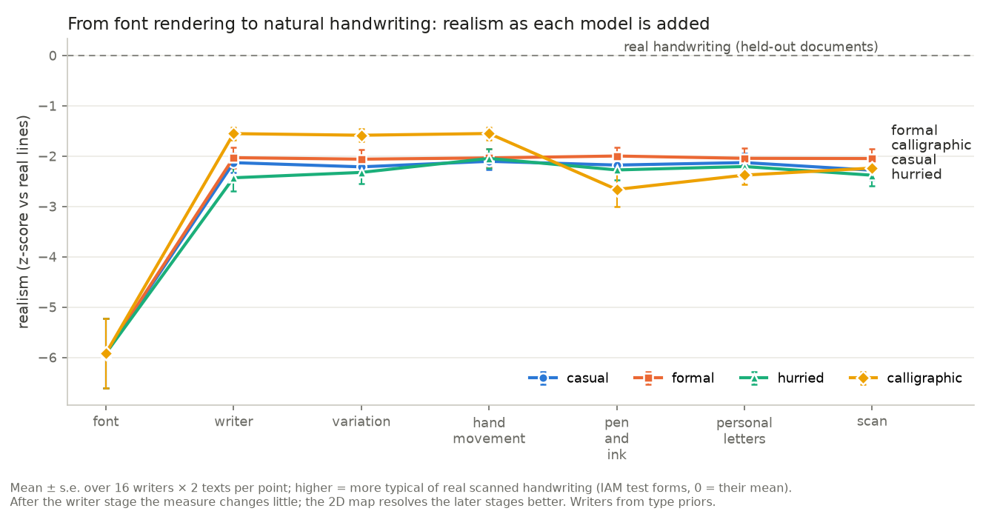
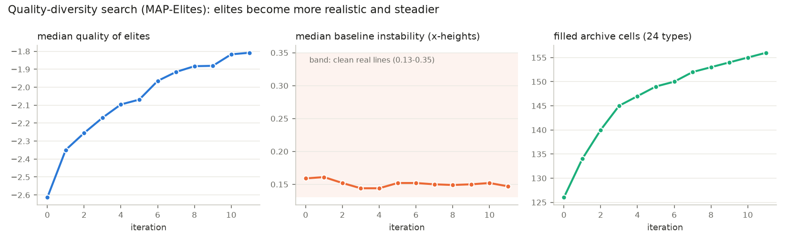

# hwsynth: natural synthetic handwriting in 153 Unicode scripts

`hwsynth` writes any text by hand in almost every script that Unicode encodes. It is not a font renderer. Letters
are traced from handwriting fonts (Noto for scripts without one) into pen paths. Those paths are rewritten by a
writer model and moved by a model of the hand (lognormal sub-movements, wrist pivots). A model of the writing tool
(17 pens, pencils, markers and nibs with pressure and angle) then puts ink on paper. Writers come in **24 handwriting
types**, each available in **10 styles**, written with either hand. A bank of individuals found by quality-diversity search keeps every
type realistic against real scanned handwriting while keeping the types apart.

It runs on CPU, needs no trained network, and uses no language model.







## Install

```bash
pip install -e .                    # core
pip install -e ".[evolve,dev]"      # search, metrics, tests
python scripts/fetch_fonts.py       # 59 handwriting fonts + 158 Noto Sans fallbacks (~190 MB, OFL/Apache)
hwsynth coverage                    # scripts that can be written
```

Fonts go to `~/.cache/hwsynth/fonts`, or set `HWSYNTH_FONTS`. Shaping needs Pillow with libraqm.

## Use

```python
import hwsynth as H

w = H.sample_writer("school_cursive", "hurried", seed=7)   # a new individual of a type, in a style
s = H.write("Meet me at the station at 5:30.", w, width_mm=120, dpi=200, scan=None)  # scan look half the time
s.image   # (H, W, 3) uint8 on paper
s.ink     # (H, W) ink density in [0, 1], for compositing on your own backgrounds
s.words   # [(text, (x0, y0, x1, y1) px, struck_out)] word boxes, for OCR / layout data
s.meta    # writer, tool, ink, x-height, hand, ruled, dpi

person, genes = H.individual("iam", seed=3)                 # a persona fitted to a real writer (or a type name)
for style in H.STYLES:                                       # ... in every situation
    H.write("Dear Anna,", H.styled(person, genes, style, seed=1))
```

Math and chemistry go inline between `$...$`, and figures are drawn by the same hand:

```python
H.write(r"Solve $x^{2}-5x+6=0$: $x=\frac{5\pm 1}{2}$; burn $\ce{CH4 + 2O2 -> CO2 + 2H2O}$ $\benzene$", w)
H.figure("axes", w, size=50)          # circle ellipse triangle square rectangle arrow star check cross axes underline
```

Supported: `^` `_` with `{...}` groups, `\frac`, `\sqrt`, Greek letters and symbols (`\int \sum \pi \infty \pm \leq ...`),
drawn arrows `-> <- => <=>`, `\ce{...}` (subscripted counts, charges, reaction arrows), `\benzene`.

```bash
hwsynth write "Привет, мир" -o hello.png --person copperplate --style formal
hwsynth examples -o examples
```

## What is modelled

| Layer | What it does | Where |
|---|---|---|
| Letters | Handwriting-font glyphs traced to centrelines (skeleton graph, straight continuation through junctions). Grapheme clusters are drawn one by one. Shaped scripts (Arabic, Indic, Southeast Asian) are drawn word by word. Bidi order is kept. | `skeleton.py`, `scripts.py`, `fonts.py` |
| Symbol habits | Crossed 7 and z, slashed zero, flagged 1, quote style, & as + (per writer, probabilities per type) | `writer.py`, `config.HABITS` |
| Writer (identity) | Slant, width, ascender and descender length, capitals, spacing, letter joins, angular or rounded movement, entry hooks and exit flicks, dot placement, pressure, allograph set with a second-allograph share, hand | `config.GENES`, `writer.py` |
| Situation (state) | Speed, care, jitter correlated between neighbouring letters, decay towards word ends, slant drift, baseline wander, cross-outs, retracing, mixed capitals | `config.STYLES`, `writer.py` |
| Hand movement | Strokes re-synthesised as overlapping lognormal sub-movements (Plamondon's Kinematic Theory). Fluent writers cut corners and careful ones reach them. Discrete-stroke scripts overlap less. Wrist pivot arcs reset at each hand shift. | `motion.py` |
| Tool and ink | 17 tools: round, broad and brush nibs; solid, viscous and fluid inks (Franke & Rose). Width and density follow speed, push and downstroke pressure. Also nib angle, ink skips, pooling, bleed, graphite grain, overlap darkening, ink-flow drift, and left-hand smudges. | `pen.py`, `config.TOOLS` |
| Paper | Tint, fibre noise, optional ruling the writer follows | `page.py` |
| Scan | Ageing paper (yellowing, foxing), fading ink, bleed-through, uneven light, greyscale/bitonal, noise, blur, dust, JPEG | `scan.py` |

**24 types** (`H.PERSONS`): school_cursive, round_print, compact_print, block_capitals, backhand, angular_cursive,
thready, wide_garland, narrow_tall, micro, expansive, arcade, print_script, elderly, child, left_hooked,
copperplate, sloppy_fast, ruled_neat, rounded_neat, bubbly_print, looped_cursive, soft_upright, artistic. The four
rounded types are round, open and regular, some with circle i-dots: the hands usually perceived as feminine. A type fixes the centre of every identity gene, and an individual
varies within ±12 % of each gene range.

**10 styles** (`H.STYLES`): casual, formal, accurate, calligraphic, professional, hurried, medical, educated,
uneducated, unsupported (written on a sheet held in the hand). A style remaps the situational genes into its own
ranges. The writer keeps its relative position inside each range, and its identity is unchanged, apart from
explicit shifts such as faster joins when hurried.

## Writer bank and evaluation

```bash
hwsynth refs --iam DIR --pdf-dir DIR  # real references: IAM forms (primary), web documents per script (secondary)
hwsynth search --iters 12           # MAP-Elites over the 24 types (checkpointed, resumable)
hwsynth fit --pages 600             # personas fitted to real writers of the IAM fit split (resumable)
hwsynth metrics -o metrics.json
```

- **Quality-diversity search (MAP-Elites).** For each type there's an archive over measured slant × pen lifts per
  letter. Each cell keeps the best individual by realism, minus a penalty for baseline instability above what real
  handwriting shows. The penalty is calibrated on real lines from scanned handwriting: clean lines run from 0.13 to
  0.35 x-heights. Individuals must also stay nearer their own type than any other.
- **Realism.** How typical a writer's lines are among real handwritten lines, measured on ResNet18 (ImageNet)
  embeddings and on 22 stroke features. Each is z-scored against real lines, leaving out the line's own document.
- **Separation.** Distance to the writer's own type centroid against the nearest other type's centroid, on two
  measures: contour-direction and contour-hinge distributions of the ink (Bulacu & Schomaker 2007, χ²), and path
  signatures of the pen trajectories (Chen; Lyons).
- **No leakage.** Real lines are split into fit and test sets by document, and documents used to label the
  handwriting filter are never test documents. Fitness and metrics use different texts. Bank admission is
  re-evaluated with fresh seeds.
- **Metrics.** Fréchet distances (embeddings, stroke features), k-NN precision and recall, diversity, writer, type
  and style identification, Tesseract character error rate, and speed. Each is compared against plain font
  rendering, random writers, type priors and ablations. See [docs/results.md](docs/results.md).

## How far it gets

On held-out IAM handwriting forms (split by form group), the searched bank closes about 71 % of the gap between
plain font rendering and real handwriting: embedding Fréchet distance 0.139, against 0.415 for fonts and 0.024
between real forms. Personas fitted to real writers reach 0.129. The 24 types are identified 52 % of the time from
other individuals (chance 4 %). Full tables are in [docs/results.md](docs/results.md), and the 2D map shows each
style's path from font rendering towards the real clouds.







## Layout

```
src/hwsynth/   config, scripts, fonts, skeleton, writer, motion, pen, page, styles, math, figures,
               realism, qd, writerid, features, metrics, cli
tests/         pytest suite (fast; font-dependent tests skip without fonts)
scripts/       fetch_fonts.py
examples/      sheets produced by `hwsynth examples`
paper/         paper (LaTeX + PDF)
```

## License

Code and documentation are licensed under [CC BY-NC 4.0](LICENSE). The fonts are not part of this repository and
keep their own licences (SIL OFL 1.1 or Apache 2.0, listed in `src/hwsynth/data/fonts.json`). `Scripts.txt` is
Unicode data under the Unicode License.

## Citation

Paper: [paper/paper.pdf](paper/paper.pdf). See also `CITATION.cff`.
